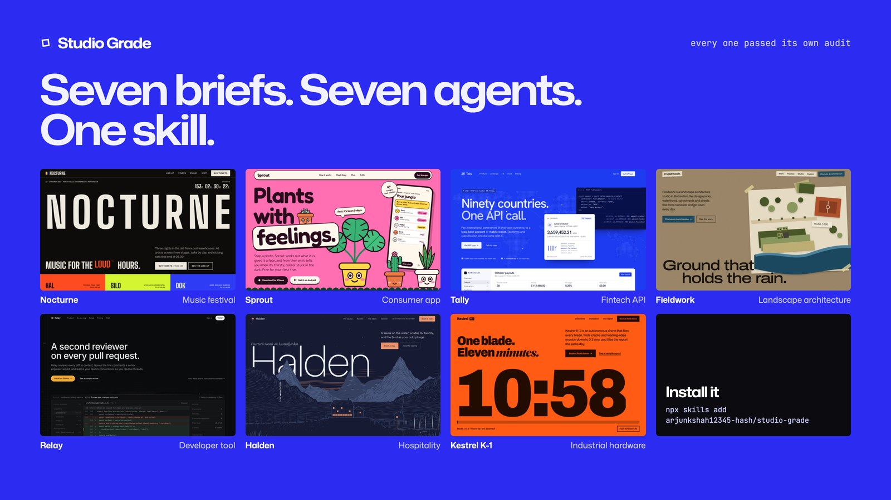
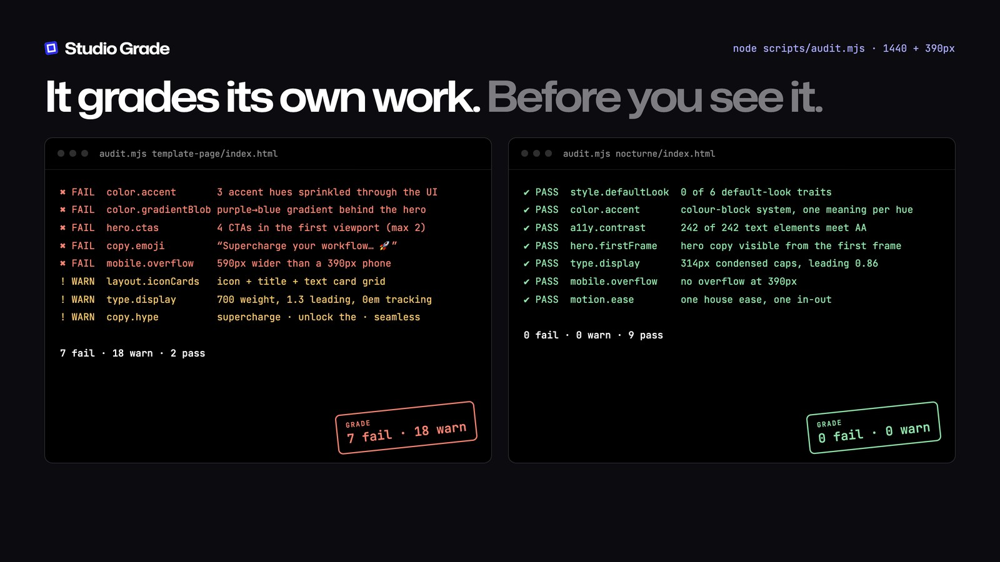

# Studio Grade

[](https://skills.sh/arjunkshah12345-hash/studio-grade/studio-grade) [](https://skills.sh/arjunkshah12345-hash/studio-grade/studio-grade) [](LICENSE)



An agent skill for studio-grade web design. It was measured from 99 live sites built by about 40 studios and in-house teams: basement.studio, Exo Ape, Work & Co, AREA 17, Locomotive, Lusion, Malvah and others. Your agent picks a direction, sets how loud to be, builds from measured tokens, and audits its own work before you see it.

```bash
npx skills add arjunkshah12345-hash/studio-grade
```

This works with Claude Code, Cursor, Codex, Windsurf, Gemini, Copilot and the other agents that support [skills.sh](https://skills.sh). The self-audit needs Playwright in the project you're building: `npm i -D playwright && npx playwright install chromium`.

**Site and work:** [studio-grade.vercel.app](https://studio-grade.vercel.app). It has seven sites built by agents that read only this skill, each with its Design Spine, palette, every screen and its audit result.

## How it works

1. **Direction and register.** Pick one of 10 measured directions, then a register (quiet, confident or loud) and five range axes (ground, type genre, image medium, composition, motion), so builds don't converge on one look.
2. **Design Spine.** Commit in writing to type, palette, motif, hero, motion and voice before any code.
3. **Tokens first.** Every value comes from a token, and text styles are bundles.
4. **Compose.** One statement and one subject per hero, chapters instead of icon cards, and no stock imagery.
5. **Craft pass.** Optical details, reduced motion, and no invented proof.
6. **Audit.** `node studio-grade/scripts/audit.mjs <page> --direction N --register R` checks 30+ rules at 1440 and 390px, flags the default AI look, and saves a screenshot of every screen for the agent to look at.

## The audit

The agent runs `scripts/audit.mjs` on its own page. Here a template page fails it, and a page built with the skill passes. The output is real, abridged.



Each rule exists because a real build needed it. One build's headings stayed blurred because a CSS selector outranked the reveal state, so `motion.stuckReveal` now fails it. Sticky headlines had text scroll over them, so `layout.textOverlap` now fails that too.

## What's in this repo

| Path | What it is |
|---|---|
| `studio-grade/` | **The skill**: SKILL.md, 12 references, assets (tokens.css, motion.js), scripts/audit.mjs. This is the only folder that gets installed. |
| `tests/builds/` | The seven showcase sites, built by agents that read only the skill. |
| `tests/feedback/` | Each test builder's notes on the skill. They drove the fixes. |
| `research/` | Per-cluster notes and the aggregate of the 99-site teardown. |
| `web/src/`, `tools/web/` | The website, built with the skill. `shoot.mjs` captures the work, and `build.mjs` writes `web/dist/`. |

## Develop the site

```bash
cd tools && npm i && cd ..
python3 -m http.server 4317 &          # serves tests/builds for shoot.mjs
node tools/web/shoot.mjs               # optional: re-capture screens into web/src/media
node tools/web/build.mjs               # → web/dist
node studio-grade/scripts/audit.mjs http://127.0.0.1:4318/ --register confident   # serve web/dist on 4318
```

## Credits

The sites studied belong to their owners and the studios that made them. We measured public pages; none of their work is reproduced here.

MIT © Arjun Shah
